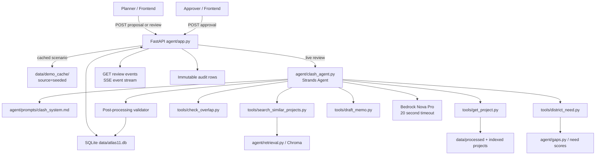

# Design Document: Atlas11 Clash Review Agent

## Overview

Atlas11 evaluates a submitted urban-project proposal against funded projects so a planner can identify duplication, coordinate overlapping scope, or proceed with complementary work. The FastAPI service owns durable proposal/review/approval state in SQLite; a single Strands agent using Amazon Bedrock Nova Pro produces only structured reasoning after deterministic Python tools supply candidate records and geography, time, sector, and district-need facts.

The 90-minute demo path is deliberately independent of Bedrock and the project index. In `DEMO_MODE=cached`, the API resolves `scenario_key=demo-city-transit-01` or proposal ID `demo-proposal-01` from `data/demo_cache/`, returns a validated seeded report with one `OVERLAPPING` and one `COMPLEMENTARY` verdict, and applies approval and gap-map redirect state locally. It never represents approval as funding, allocation, or delivery.

## Architecture



**Boundary decisions**
- `agent/app.py` handles HTTP validation, review lifecycle, SSE delivery, cache routing, and exception-to-status mapping. Cached-mode logic is at this API boundary, never hidden inside the Strands agent.
- `agent/clash_agent.py` constructs one Strands `Agent` from the prompt file and invokes it only for live reviews. No prompt text is embedded in Python.
- Every `agent/tools/` module has one model-facing tool, Pydantic input/output models, and a docstring written as the tool description. Tools calculate facts; the model interprets those facts.
- `agent/store.py` is the only SQLite boundary for proposals, reviews, approvals, and audit entries. Stable IDs (`proposal_id`, `review_id`, `project_id`, `district_id`, `approval_id`) remain unchanged across API, cached payloads, and frontend contracts.

## Sequence Diagrams

### Live review

```mermaid
sequenceDiagram
    participant P as Planner
    participant API as FastAPI
    participant DB as SQLite
    participant A as Strands / Nova Pro
    participant T as Deterministic tools
    participant V as Report validator

    P->>API: POST /proposals/{id}/review
    API->>DB: load SUBMITTED proposal; create review
    API-->>P: 202 {review_id}
    P->>API: GET /reviews/{id}/events
    API-->>P: status {"Review started"}
    API->>A: run proposal context
    A->>T: search_similar_projects(text, k<=8)
    T-->>A: project IDs + scores
    API-->>P: tool_call {name, ms}
    loop at most five filtered candidates
        A->>T: get_project(project_id)
        A->>T: check_overlap(proposal, project_id)
        T-->>A: deterministic evidence
        API-->>P: tool_call {name, ms}
    end
    A->>T: district_need(district_id), draft_memo(verdicts)
    A-->>API: JSON candidate verdicts + memo
    API->>V: parse and enforce taxonomy
    V->>DB: persist report; SUBMITTED -> REVIEWED; audit
    API-->>P: verdict events
    API-->>P: done {review_id, report reference}
```

### Cached canonical review and approval

```mermaid
sequenceDiagram
    participant P as Planner
    participant API as FastAPI
    participant Cache as data/demo_cache
    participant DB as SQLite
    participant A as Approver

    P->>API: POST /proposals/demo-proposal-01/review
    API->>Cache: resolve canonical scenario / proposal
    Cache-->>API: validated seeded ClashReport
    API->>DB: persist review; SUBMITTED -> REVIEWED; audit
    API-->>P: review_id
    P->>API: GET /reviews/{id}/events
    API-->>P: status, tool_call(s), verdict(s), done
    A->>API: POST /approvals {role=approver, decision}
    API->>DB: REVIEWED -> APPROVED or REJECTED
    API->>DB: audit approval and redirect display target
    API-->>A: Approval (coordination sign-off only)
```

## Components and Interfaces

### API and lifecycle service

```python
from collections.abc import AsyncIterator
from typing import Literal

from fastapi import FastAPI
from agent.schemas import Approval, ApprovalCreate, ClashReport, Proposal, ReviewCreated, SseEvent

app = FastAPI()

@app.post("/proposals", response_model=Proposal, status_code=201)
def create_proposal(payload: "ProposalCreate") -> Proposal: ...

@app.post("/proposals/{proposal_id}/review", response_model=ReviewCreated, status_code=202)
def request_review(proposal_id: str, scenario_key: str | None = None) -> ReviewCreated: ...

@app.get("/reviews/{review_id}/events")
def stream_review_events(review_id: str) -> AsyncIterator[str]: ...

@app.get("/reviews/{review_id}", response_model=ClashReport)
def get_review(review_id: str) -> ClashReport: ...

@app.post("/approvals", response_model=Approval, status_code=201)
def record_approval(payload: ApprovalCreate) -> Approval: ...

@app.get("/audit", response_model=list["AuditEvent"])
def list_audit(proposal_id: str | None = None, review_id: str | None = None) -> list["AuditEvent"]: ...
```

`POST /proposals/{proposal_id}/review` accepts only a stored `SUBMITTED` proposal and returns a generated `review_id`; processing may proceed asynchronously. Calling it for `REVIEWED`, `APPROVED`, or `REJECTED` returns a readable conflict response and does not create a second review. The report endpoint is unavailable until the review reaches completion.

### Live agent orchestration

```python
from agent.schemas import ClashReport, Proposal

class ClashAgentService:
    """Runs a constrained Strands review against deterministic tool evidence."""

    def review(self, proposal: Proposal, review_id: str) -> ClashReport: ...


def build_clash_agent() -> "Agent": ...
def load_system_prompt() -> str: ...
def invoke_with_schema_retry(proposal: Proposal) -> ClashReport: ...
```

`build_clash_agent()` configures one Strands `Agent` with Nova Pro model ID from refreshed environment configuration and a 20-second Bedrock timeout. `load_system_prompt()` reads `agent/prompts/clash_system.md`, which contains taxonomy and structured-output instructions but no geography/time calculations. Agent output is parsed as `ClashReport`; on the first parsing failure, invocation retries once with the Pydantic validation errors. A second failure becomes a readable HTTP 502 and an audit event, never an unvalidated response.

### Model-facing tools

```python
class SimilarProjectSearchInput(BaseModel):
    proposal_text: str = Field(min_length=1)
    k: int = Field(default=8, ge=1, le=8)

class SimilarProjectSearchOutput(BaseModel):
    candidates: list[Candidate]

class GetProjectInput(BaseModel):
    project_id: str = Field(min_length=1)

class OverlapCheckInput(BaseModel):
    proposal: Proposal
    project_id: str = Field(min_length=1)

class OverlapFacts(BaseModel):
    same_city: bool
    same_district: bool
    districts_known: bool
    dates_known: bool
    periods_overlap_with_slack: bool
    same_sector: bool
    shared_beneficiaries: bool | None
    matching_attributes: list[str]
    evidence_project_id: str

class DistrictNeedInput(BaseModel):
    district_id: str = Field(min_length=1)

class DraftMemoInput(BaseModel):
    verdicts: list[Verdict]
```

| Tool file | Contract | Deterministic responsibility |
|---|---|---|
| `search_similar_projects.py` | `search_similar_projects(proposal_text, k)` → IDs and scores only | Calls shared retrieval with `k <= 8`; initial filtering is city, optional district, sector, and implementation window. |
| `get_project.py` | `get_project(project_id)` → `Project` | Loads a canonical record and provenance, or returns a typed not-found error. |
| `check_overlap.py` | `check_overlap(proposal, project_id)` → `OverlapFacts` | Canonical city/district comparisons, inclusive dates plus exactly 12 months slack at both ends, sector evidence, beneficiary/output facts. |
| `district_need.py` | `district_need(district_id)` → need and funding facts | Returns local need score and current funding context; it does not infer a funding outcome. |
| `draft_memo.py` | `draft_memo(verdicts)` → `Memo` | Selects a consistent recommendation and structured memo from validated verdicts; a redirect is a display coordination target only. |

Tool calls are timed at the service boundary, emitted as SSE `tool_call` events, and written to audit. The model receives no more than five candidates after deterministic filtering even if retrieval returns eight.

## Data Models

```python
from datetime import date, datetime
from enum import StrEnum
from typing import Literal
from pydantic import BaseModel, Field, model_validator

class ProposalStatus(StrEnum):
    SUBMITTED = "SUBMITTED"
    REVIEWED = "REVIEWED"
    APPROVED = "APPROVED"
    REJECTED = "REJECTED"

class VerdictLabel(StrEnum):
    DUPLICATE = "DUPLICATE"
    OVERLAPPING = "OVERLAPPING"
    COMPLEMENTARY = "COMPLEMENTARY"
    UNRELATED = "UNRELATED"

class Recommendation(StrEnum):
    MERGE = "MERGE"
    CO_FINANCE = "CO_FINANCE"
    PROCEED = "PROCEED"
    REDIRECT = "REDIRECT"

class Role(StrEnum):
    PLANNER = "planner"
    APPROVER = "approver"

class ProposalCreate(BaseModel):
    title: str = Field(min_length=1, max_length=300)
    description: str = Field(min_length=1, max_length=10000)
    city_id: str = Field(min_length=1)
    district_id: str | None = None
    sector: str = Field(min_length=1)
    budget_usd: Decimal = Field(ge=0)
    start_date: date | None = None
    end_date: date | None = None
    scenario_key: str | None = None
    source: Literal["seeded", "user"] = "user"

class Proposal(ProposalCreate):
    proposal_id: str
    status: ProposalStatus = ProposalStatus.SUBMITTED
    submitted_at: datetime

class Verdict(BaseModel):
    project_id: str = Field(min_length=1)
    label: VerdictLabel
    confidence: float = Field(ge=0.0, le=1.0)
    matching_attributes: list[str] = Field(default_factory=list)
    reasoning: str = Field(min_length=1)

class Memo(BaseModel):
    recommendation: Recommendation
    summary: str = Field(min_length=1)
    redirect_district_id: str | None = None

class ClashReport(BaseModel):
    proposal_id: str
    candidates: list[Verdict]
    memo: Memo
    model_id: str
    latency_ms: int = Field(ge=0)
    source: Literal["live", "seeded"]

class ApprovalCreate(BaseModel):
    review_id: str
    decision: Literal["APPROVED", "REJECTED"]
    actor: str = Field(min_length=1)
    role: Role
    reason: str | None = None

class Approval(BaseModel):
    approval_id: str
    review_id: str
    proposal_id: str
    decision: Literal["APPROVED", "REJECTED"]
    actor: str
    decided_at: datetime
    reason: str | None = None

    @model_validator(mode="after")
    def rejected_requires_reason(self) -> "Approval": ...

class SseEvent(BaseModel):
    type: Literal["status", "tool_call", "verdict", "done", "error"]
    name: str | None = None
    ms: int | None = Field(default=None, ge=0)
    payload: dict[str, object] | None = None

class AuditEvent(BaseModel):
    event_id: str
    event_type: str
    timestamp: datetime
    proposal_id: str | None = None
    review_id: str | None = None
    project_id: str | None = None
    approval_id: str | None = None
    actor: str | None = None
    role: Role | None = None
    payload_summary: str
```

Validation rules:
- Proposal dates, when both supplied, must be ordered. Unknown district remains `None`; it never matches a project district.
- All IDs are stable canonical IDs, not display names. Project provenance remains on the project record; cached report and proposal sources are visibly `seeded`.
- Every verdict uses one closed label and a finite confidence in `[0, 1]`.
- `redirect_district_id` is allowed only for `REDIRECT`; a redirect changes map focus/coordination target and never funding.
- Rejection requires a non-empty reason; approval may omit one.

### SQLite persistence

```text
proposals(proposal_id PK, status, city_id, district_id, sector, payload_json, submitted_at)
reviews(review_id PK, proposal_id FK, report_json, source, created_at, completed_at)
approvals(approval_id PK, review_id FK, proposal_id FK, decision, actor, reason, decided_at)
audit_events(event_id PK, event_type, proposal_id, review_id, project_id, approval_id,
             actor, role, timestamp, payload_summary)
```

Store operations use transactions around review completion and approval transitions so the durable status, report/approval row, and required audit events commit together. Audit entries are append-only through the application API.

## Core Algorithms

### Candidate selection and deterministic facts

```python
def select_candidates(proposal: Proposal) -> list[Candidate]:
    filters = {
        "city": proposal.city_id,
        "sector": proposal.sector,
        "district": proposal.district_id,
        "approval_date_from": proposal.start_date,
        "closing_date_to": proposal.end_date,
    }
    candidates = search(proposal.description, k=8, filters=remove_none(filters))
    return candidates[:5]
```

**Preconditions:** proposal exists, is `SUBMITTED`, and uses canonical city ID; retrieval receives only supported, non-null filters.

**Postconditions:** returns at most five unique project IDs from an initial set of at most eight, all satisfying applicable deterministic filters; the model is never sent more candidates.

**Loop invariant:** after processing candidate `n`, all selected entries are unique and retain their retrieval order.

`check_overlap` applies this exact predicate for date evidence. It extends each known inclusive interval by 12 calendar months (`start - 12 months`, `end + 12 months`) and evaluates intersection inclusive of boundary dates. When either proposal or candidate lacks a start/end date, `dates_known=False`, `periods_overlap_with_slack=False`, and no duplicate/overlap label may rely on time evidence.

### Taxonomy post-processing validator

```python
def validate_verdict(proposal: Proposal, verdict: Verdict, facts: OverlapFacts) -> Verdict:
    label = verdict.label
    attributes = deduplicate_evidence(verdict.matching_attributes, facts.matching_attributes)

    if not facts.same_city and label in {VerdictLabel.DUPLICATE, VerdictLabel.OVERLAPPING}:
        label = VerdictLabel.COMPLEMENTARY if facts.same_sector else VerdictLabel.UNRELATED

    if (not facts.dates_known or not facts.periods_overlap_with_slack) and label in {
        VerdictLabel.DUPLICATE,
        VerdictLabel.OVERLAPPING,
    }:
        label = VerdictLabel.COMPLEMENTARY if facts.same_sector else VerdictLabel.UNRELATED

    if label is VerdictLabel.DUPLICATE and len(attributes) < 2:
        label = VerdictLabel.OVERLAPPING
        record_downgrade_audit(...)

    return verdict.model_copy(update={"label": label, "matching_attributes": attributes})
```

**Preconditions:** proposal, referenced project, and `OverlapFacts` have been validated; verdict has valid enum/confidence fields.

**Postconditions:** a different city can never yield `DUPLICATE` or `OVERLAPPING`; missing/non-overlapping implementation intervals cannot justify either label; every final duplicate has at least two matching attributes; all model downgrades are auditable. Same-city, different-district pairs are at most `OVERLAPPING` only with shared beneficiaries. Concrete outputs, not generic wording, determine duplicate severity.

**Loop invariant:** each processed verdict has exactly one valid label, bounded confidence, cited project ID, and taxonomy-compliant severity.

### Schema retry and review completion

```python
def produce_validated_report(proposal: Proposal) -> ClashReport:
    first_output = invoke_nova_pro(proposal, timeout_seconds=20)
    try:
        return ClashReport.model_validate_json(first_output)
    except ValidationError as first_error:
        retry_output = invoke_nova_pro(
            proposal,
            validation_feedback=first_error.errors(),
            timeout_seconds=20,
        )
        try:
            return ClashReport.model_validate_json(retry_output)
        except ValidationError as second_error:
            raise AgentOutputInvalidError("Agent response could not be validated") from second_error
```

**Preconditions:** live mode, refreshed AWS credentials, and deterministic evidence available.

**Postconditions:** returns only a validated report or raises a readable error that maps to HTTP 502. It performs at most two model invocations and does not change proposal status until report validation and taxonomy enforcement succeed.

### Approval state machine

```mermaid
stateDiagram-v2
    [*] --> SUBMITTED: POST /proposals
    SUBMITTED --> REVIEWED: validated review completes
    REVIEWED --> APPROVED: role=approver; approve
    REVIEWED --> REJECTED: role=approver; non-empty reason
    APPROVED --> [*]
    REJECTED --> [*]
```

```python
def apply_approval(proposal: Proposal, request: ApprovalCreate) -> Approval:
    if proposal.status is not ProposalStatus.REVIEWED:
        raise InvalidTransitionError(...)
    if request.role is not Role.APPROVER:
        raise AuthorizationError(...)
    if request.decision == "REJECTED" and not nonempty(request.reason):
        raise ValidationError(...)
    return store_transition_and_audit(proposal, request)
```

**Preconditions:** referenced review exists and belongs to the proposal; proposal is `REVIEWED`.

**Postconditions:** only an approver can transition to `APPROVED` or `REJECTED`; transition cannot skip `REVIEWED`; a rejection has a reason; no state transition calls payment/funding services or alters commitments.

## Correctness Properties

### Property 1: Deterministic overlap symmetry

**Validates: Requirements 11.1**

For any two fully specified proposal/project representations, swapping the operands preserves geography equality and inclusive date-overlap-with-slack facts.

### Property 2: Cross-city severity

**Validates: Requirements 11.2**

For any proposal and candidate with distinct canonical city IDs, validation returns neither `DUPLICATE` nor `OVERLAPPING`.

### Property 3: Duplicate evidence minimum

**Validates: Requirements 11.3**

For every validated verdict, `label == DUPLICATE` implies `len(matching_attributes) >= 2`.

### Property 4: Closed verdict contract

**Validates: Requirements 11.4**

For every accepted verdict, the label is in the four-value taxonomy and confidence is finite and in `[0, 1]`.

### Property 5: Approval reachability

**Validates: Requirements 11.5**

For any generated action sequence and actor roles, reaching `APPROVED` or `REJECTED` requires a final approver action from `REVIEWED`; no action can move directly from `SUBMITTED` to a terminal state.

### Property 6: SSE ordering

**Validates: Requirements 11.6**

For any successful review stream, `status` is first, zero or more `tool_call` events precede zero or more `verdict` events, and one final `done` event ends the stream; failed streams end in `error` and do not emit `done`.

### Property 7: Candidate limit

**Validates: Requirements 11.7**

For every live review, retrieval returns at most eight candidates, the model receives at most five candidates, and candidate IDs are unique and ordered by the shared retrieval contract.

### Property 8: Cached isolation

**Validates: Requirements 11.8**

For any canonical cached review, execution invokes neither Bedrock nor live retrieval and returns a seeded report that parses as `ClashReport`.

## Error Handling

| Condition | API behavior | Durable/audit behavior |
|---|---|---|
| Missing proposal | `404` readable detail | No transition; optional request failure audit. |
| Review requested outside `SUBMITTED` | `409` | No review/report created; record rejected transition. |
| Retrieval/project/tool error | Stream `error` with readable payload; review fails | Tool timing/error audit; proposal stays `SUBMITTED`. |
| Bedrock timeout/non-credential service error | Stream `error`; non-stream request returns readable `502/503` as appropriate | Audit error; proposal stays `SUBMITTED`; cached mode remains available. |
| `ExpiredToken`, `ExpiredTokenException`, `UnrecognizedClientException` | HTTP `503` body `{ "error": "AWS credentials expired. Refresh agent/.env from Workshop Studio." }` | Audit sanitized credential failure; never log secrets. |
| Invalid first model JSON | One retry with validation feedback | Audit schema-retry event. |
| Invalid second model JSON | HTTP `502` readable error | Audit validation failure; no report/status change. |
| Cache missing/unreadable in cached mode | `503`/stream error explaining cached report unavailable | Preserve proposal and prior review data; do not call Bedrock. |
| Planner tries approval | `403` | Audit denied authorization. |
| Rejection without reason | `422` | No state change; audit rejected request. |

Credential configuration reloads `agent/.env` and recreates the boto3 session for each live review (or after a credential failure), allowing Workshop credentials to be refreshed without restarting the API. Credential values and raw session tokens are never returned, stored, or logged.

## Testing Strategy

### Unit tests
- Pydantic contract tests for proposal dates, bounded confidence, memo redirect rules, approval rejection reason, and exact enum values.
- Tool tests for retrieval cap, canonical record lookup, `check_overlap` city/district/date/sector fact generation, local district need, and memo selection.
- Validator tests for cross-city downgrades, date-conservative downgrades, same-city different-district beneficiary rule, duplicate evidence downgrade/audit, and preservation of non-severe labels.
- Store tests for atomic review completion, permitted/denied transitions, append-only audit content, and no duplicate approvals.
- API tests for every listed endpoint, response status, cache routing, error mapping, and exact credential-expired payload.
- SSE tests for payload shape and success/error event ordering.

### Required Hypothesis property-based tests
- Generate date intervals and canonical location pairs to prove overlap symmetry and inclusive 12-month-slack boundary behavior.
- Generate pairs with different city IDs to prove final label exclusion of `DUPLICATE` and `OVERLAPPING`.
- Generate valid/invalid evidence lists to prove no final duplicate has fewer than two matching attributes.
- Generate verdict payloads to prove closed-label and confidence bounds are enforced.
- Generate action/role sequences to prove terminal approval/rejection states cannot be reached without an approver transition from `REVIEWED`.
- Reuse the data-pipeline retrieval property: `search` yields at most `k`, unique IDs, descending scores.

### Integration and smoke tests
- Mock Strands/Nova Pro outputs for valid JSON, retry-success, retry-failure, and credential expiry.
- Run an API + temporary SQLite test for submit → review → SSE → report → approver action → audit.
- Run `DEMO_MODE=cached` canonical scenario locally without AWS credentials or Chroma, asserting both required verdict labels, `CO_FINANCE` memo, redirect district, seeded source, approval/rejection behavior, and local gap response.
- Use this cached end-to-end scenario as the minimal pipeline/API/frontend shared-ID integration gate. Live Bedrock reachability and full golden evaluation remain secondary to this gate.

## Evaluation, Operations, and Dependencies

`agent/eval.py` reads hand-labelled `data/eval/golden_pairs.jsonl`; `python -m agent.eval --quick` evaluates the first six pairs and full mode evaluates all valid pairs. Both report label accuracy/confusion details, preserve case-level evidence, and append timestamped results to `.kiro/evidence/eval-history.csv` without secrets. Prompt changes to `agent/prompts/clash_system.md` are regression checked by the configured hook; a prompt regression must not be merged.

The required evaluation set grows to at least 12 labelled pairs through the `clash-eval` workflow and data stewardship, covering all four labels, city/date boundary cases, same-city/different-district cases, missing dates, and the scripted cached scenario. Evaluation labels are human-reviewed references rather than claimed funding facts.

Dependencies are Python 3.11+, FastAPI/Uvicorn, Pydantic, Strands Agents SDK, boto3/botocore, SQLite, python-dotenv, pytest, and Hypothesis. The agent consumes the existing Chroma retrieval boundary and local gap data; it adds no hosted datastore or payment integration. All Python imports are absolute from the package root, and all external agent output is schema-validated before reaching the API response.
