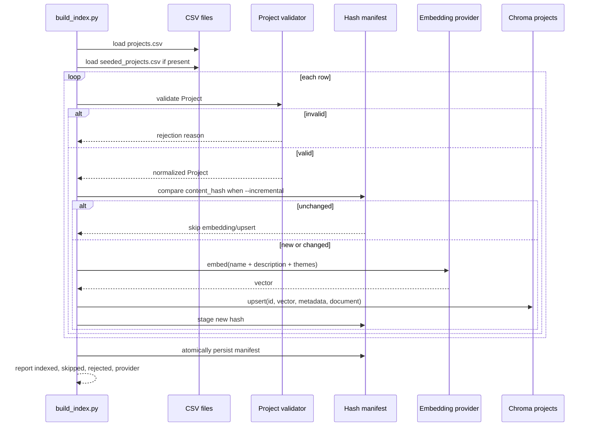
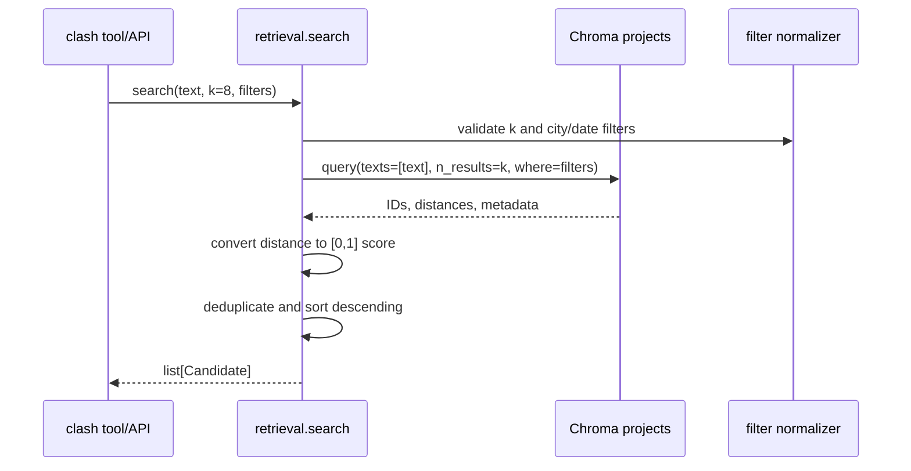

# Design Document: Atlas11 Data Pipeline

## Overview

The data pipeline turns normalized project CSV files into a persistent Chroma `projects` collection used by Atlas11 clash review. `scripts/build_index.py` loads the authoritative World Bank-derived `data/processed/projects.csv` and, when present, the separate demo-only `data/processed/seeded_projects.csv`; validates every row with a Pydantic `Project`; builds an embedding input from `name`, `description`, and `themes`; and upserts vectors plus filterable metadata into `data/index/`.

`agent/retrieval.py` provides a small, stable search contract for the rest of the application. It applies city and inclusive implementation date-window filters in Chroma, returns at most `k` unique `Candidate` values with normalized scores in descending order, and never requires Bedrock when the local provider is selected. `scripts/check_aws.py` is an operational diagnostic for Nova Pro and Titan embeddings. The design does not modify application code; implementation is limited to the pipeline, retrieval module, diagnostics, tests, configuration, and generated data/index artifacts.

## Architecture

```mermaid
graph TD
    A[data/processed/projects.csv\nWorld Bank / IATI normalized] --> C[CSV loader]
    B[data/processed/seeded_projects.csv\nsource=seeded, optional] --> C
    C --> D[Pydantic Project validation]
    D -->|valid rows| E[Canonical text + SHA-256 content hash]
    D -->|invalid rows| R[Rejected-row report]
    E --> F{EMBEDDINGS_PROVIDER}
    F -->|bedrock| G[Titan Text Embeddings V2\nBedrock runtime]
    F -->|local| H[sentence-transformers\nall-MiniLM-L6-v2]
    G --> I[Chroma PersistentClient\ndata/index/]
    H --> I
    E --> J[Incremental hash manifest]
    J --> I
    I --> K[projects collection]
    K --> L[agent/retrieval.search]
    L --> M[list[Candidate]]
    N[scripts/check_aws.py] --> G
    N --> O[Nova Pro + Titan callable report]
```

### Data flow

1. Resolve paths relative to the repository root, not the current shell directory.
2. Require `projects.csv`; if it is absent, stop with an actionable message to run the `worldbank-ingest` skill. The ingest currently produces World Bank rows under `source=worldbank_api` and keeps raw files untouched. Do not silently build an empty index.
3. Load `projects.csv` and append `seeded_projects.csv` only when it exists. Never copy seeded rows into the authoritative CSV; every seeded row must have `source=seeded`.
4. Validate each row independently. Valid rows continue; invalid rows are rejected with row number, project ID if available, and Pydantic error text.
5. Canonicalize the embedding text and metadata, hash the canonical record, embed changed rows, then upsert by stable `project_id`.
6. Persist the Chroma collection and hash manifest atomically enough that a failed batch does not replace the last known-good manifest.

## Sequence Diagrams

### Build and incremental indexing



### Retrieval



## Components and Interfaces

### `scripts/build_index.py`

**Purpose:** command-line orchestration for validation, embedding, incremental indexing, and reporting.

```python
from collections.abc import Iterable, Sequence
from pathlib import Path
from typing import Protocol

from agent.schemas import Project

class EmbeddingProvider(Protocol):
    name: str
    model_id: str

    def embed_documents(self, texts: Sequence[str]) -> list[list[float]]: ...

    def embed_query(self, text: str) -> list[float]: ...


def load_projects(
    projects_path: Path,
    seeded_path: Path,
) -> tuple[list[Project], list["RejectedRow"]]: ...


def canonical_embedding_text(project: Project) -> str: ...


def content_hash(project: Project) -> str: ...


def build_index(
    *,
    root: Path,
    provider: EmbeddingProvider,
    incremental: bool = False,
) -> "IndexReport": ...
```

### `agent/retrieval.py`

```python
from datetime import date
from typing import TypedDict

from agent.schemas import Candidate

class SearchFilters(TypedDict, total=False):
    city: str
    district: str
    approval_date_from: date
    approval_date_to: date
    closing_date_from: date
    closing_date_to: date


def search(
    text: str,
    k: int = 8,
    filters: SearchFilters | None = None,
) -> list[Candidate]: ...
```

`Candidate` is the shared Pydantic payload and contains exactly the stable project ID and normalized similarity score needed by the clash agent. Retrieval may use Chroma metadata internally, but must not leak backend-specific result shapes through this interface.

### `scripts/check_aws.py`

```python
class ServiceCheck(BaseModel):
    service: Literal["nova_pro", "titan_embeddings"]
    callable: bool
    model_id: str
    detail: str
    token_expires_in_seconds: int | None = None


def check_bedrock() -> list[ServiceCheck]: ...
```

The CLI prints a human-readable report and exits non-zero if either requested model is not callable. It must never print credentials or token values.

## Data Models

### Project

The canonical model lives in `agent/schemas.py` and is reused by the pipeline and API. Fields correspond to the normalized ingest schema; optional source fields are retained for provenance even when not indexed as metadata.

```python
from datetime import date
from decimal import Decimal
from pydantic import BaseModel, ConfigDict, Field, field_validator

class Project(BaseModel):
    model_config = ConfigDict(extra="ignore", str_strip_whitespace=True)

    project_id: str = Field(min_length=1)
    name: str = Field(min_length=1)
    funder: str = Field(min_length=1)
    country: str = Field(min_length=1)
    city: str | None = None
    district: str | None = None
    sector: str = Field(min_length=1)
    themes: str = ""
    description: str = ""
    amount_usd: Decimal = Field(ge=0)
    approval_date: date | None = None
    closing_date: date | None = None
    status: str | None = None
    is_urban: bool = True
    source: Literal["worldbank_api", "iati", "seeded"]
    source_url: str | None = None

    @field_validator("source")
    @classmethod
    def seeded_is_explicit(cls, value: str) -> str:
        return value
```

Validation rules:
- `project_id`, `name`, `funder`, `country`, and `sector` are non-empty after trimming.
- `amount_usd` is non-negative and finite.
- Dates use ISO `YYYY-MM-DD` after accepting the known World Bank date forms during CSV parsing; if both dates exist, closing date must not precede approval date.
- `source` is a closed provenance enum. Rows in `seeded_projects.csv` with a source other than `seeded` are rejected; seeded rows found in `projects.csv` are also rejected to preserve provenance boundaries.
- `source_url` is optional for seeded records but required for `worldbank_api` and `iati` rows.
- Empty optional CSV cells become `None`, not the strings `"None"` or `"null"`.

### Search payloads

```python
class Candidate(BaseModel):
    project_id: str = Field(min_length=1)
    score: float = Field(ge=0.0, le=1.0)

class RejectedRow(BaseModel):
    file: str
    row_number: int
    project_id: str | None = None
    reason: str

class IndexReport(BaseModel):
    provider: str
    indexed: int
    skipped_unchanged: int
    rejected: list[RejectedRow]
    collection: str = "projects"
```

### Chroma document and metadata contract

Each Chroma record has:

```python
{
    "id": project.project_id,
    "document": canonical_embedding_text(project),
    "embedding": vector,
    "metadata": {
        "city": project.city or "",
        "district": project.district or "",
        "sector": project.sector,
        "funder": project.funder,
        "approval_date": project.approval_date.isoformat() if project.approval_date else "",
        "closing_date": project.closing_date.isoformat() if project.closing_date else "",
        "amount_usd": float(project.amount_usd),
        "source": project.source,
        "content_hash": content_hash(project),
    },
}
```

The requested filter metadata is always present, using an empty string for unknown optional values. Dates are stored in ISO format so lexicographic range comparisons preserve chronological order. The manifest stores the same hash plus provider/model metadata and is not the source of truth for project content.

## Configuration and Dependencies

| Setting | Default | Behavior |
|---|---|---|
| `EMBEDDINGS_PROVIDER` | `local` for offline-safe builds | `bedrock` selects Titan; `local` selects MiniLM |
| `BEDROCK_EMBEDDING_MODEL_ID` | `amazon.titan-embed-text-v2:0` | Titan Text Embeddings V2 model ID exposed by the account |
| `BEDROCK_NOVA_MODEL_ID` | `us.amazon.nova-pro-v1:0` | Diagnostic-only Nova Pro model ID |
| `AWS_REGION` | `us-east-1` | Loaded from `agent/.env` through `python-dotenv` |
| `CHROMA_PATH` | `data/index/` | Persistent local Chroma path |
| `CHROMA_COLLECTION` | `projects` | Stable collection name |
| `DEMO_MODE` | unset | Cached demo path does not require this pipeline or Bedrock |

Dependencies are the existing Python 3.11+ environment, Pydantic, ChromaDB, boto3/botocore, python-dotenv, and sentence-transformers for local embeddings. No hosted vector database or additional account is introduced. Local mode must not initialize a Bedrock client or make network calls. Bedrock calls have a 20-second timeout where the SDK permits it.

Credential handling:
- Read credentials only from environment variables loaded from `agent/.env`; never hard-code, print, or persist them.
- Recreate or refresh the boto3 session for each diagnostic/build invocation so an updated `.env` is picked up without a process restart.
- Map `ExpiredTokenException`, `UnrecognizedClientException`, and `ExpiredToken` to a `CredentialsExpired` error with the exact message: `AWS credentials expired. Refresh agent/.env from Workshop Studio.`
- `build_index.py` reports the readable error and exits non-zero; `retrieval.search` must not silently fall back from a Bedrock-built index to unrelated data. Cached demo review remains independent of this index.

## Core Algorithms

### Canonical text and content hash

```python
def canonical_embedding_text(project: Project) -> str:
    fields = (project.name, project.description, project.themes)
    return "\n".join(value.strip() for value in fields)


def content_hash(project: Project) -> str:
    canonical = project.model_dump(mode="json", exclude_none=False)
    payload = json.dumps(canonical, sort_keys=True, separators=(",", ":"))
    return hashlib.sha256(payload.encode("utf-8")).hexdigest()
```

The hash includes all validated project fields, not only embedding text, so metadata-only changes are also re-upserted. Hash input is deterministic across CSV column order and process runs.

### Incremental build

```pascal
ALGORITHM build_index(root, provider, incremental)
INPUT: repository root, embedding provider, incremental flag
OUTPUT: IndexReport

BEGIN
  ASSERT root/data/processed/projects.csv EXISTS
  rows ← load projects.csv and optional seeded_projects.csv
  valid, rejected ← validate each row independently with Project
  old_hashes ← read root/data/index/index_manifest.json if incremental
  changed ← empty list

  FOR each project IN valid DO
    current_hash ← content_hash(project)
    IF incremental AND old_hashes[project.project_id] = current_hash THEN
      skipped ← skipped + 1
    ELSE
      changed.append(project)
    END IF
  END FOR

  vectors ← provider.embed_documents(map canonical_embedding_text over changed)
  ASSERT length(vectors) = length(changed)
  upsert changed records into persistent Chroma collection "projects"
  atomically write new manifest only after all upserts succeed
  RETURN report(indexed=length(changed), skipped_unchanged=skipped, rejected=rejected)
END
```

A full rebuild embeds every valid row and upserts it. Incremental mode only skips rows whose validated content hash is unchanged; removed CSV rows are deleted from the collection by comparing the current valid ID set with the previous manifest, preventing stale projects from remaining searchable. Duplicate project IDs across the two files are rejected as a row-level conflict and never silently overwrite one another.

### Embedding providers

`BedrockEmbeddingProvider` batches requests where supported, parses Titan’s returned float vector, and retries transient failures with bounded backoff. It raises `CredentialsExpired` for expired/invalid credentials and `EmbeddingProviderError` for other failures. `LocalEmbeddingProvider` loads `sentence-transformers/all-MiniLM-L6-v2` once per process and uses `encode(..., normalize_embeddings=True)`; model download is outside the build path and a missing local model produces an actionable offline-install error rather than a network attempt.

### Retrieval and score normalization

Chroma returns distances whose exact scale depends on the configured metric. The collection uses cosine distance. For every result:

```python
def normalize_distance(distance: float) -> float:
    if not math.isfinite(distance):
        return 0.0
    return max(0.0, min(1.0, 1.0 - distance))
```

`search` validates `k >= 1`, caps excessively large values at the configured maximum, compiles only supported filters, queries Chroma with `n_results=k`, converts distances, removes duplicate IDs while retaining the highest score, sorts by `(-score, project_id)`, and returns the first `k`. City and district equality filters are canonical ID/value filters. Date-window filters use inclusive overlap: a project is eligible when its known approval/closing interval intersects the requested window; missing dates are conservatively excluded when the corresponding date constraint cannot be evaluated. The function does not infer dates.

## Key Functions with Formal Specifications

### `load_projects`

**Preconditions:** `projects_path` is a readable CSV path; `seeded_path` may not exist.

**Postconditions:** Returns valid `Project` objects and a rejection for every invalid row; never raises for one malformed row; fails clearly if the required primary file is absent; preserves source provenance.

**Loop invariant:** Every row already visited has exactly one outcome: valid project or `RejectedRow`.

### `build_index`

**Preconditions:** provider is initialized; Chroma path is writable; primary CSV exists.

**Postconditions:** Every valid non-duplicate row is searchable with its stable ID and required metadata; no rejected row is upserted; incremental unchanged rows cause zero embedding calls; manifest is updated only after successful upserts.

**Loop invariant:** The staged manifest contains hashes only for validated rows; the previous committed manifest remains recoverable until commit.

### `search`

**Preconditions:** `text` is non-empty after trimming; `k` is a positive integer; filters contain only supported fields and valid date ranges.

**Postconditions:** Returns `0 <= len(result) <= k`, unique project IDs, scores in `[0,1]`, and non-increasing score order. No network call is made in local-provider operation.

**Loop invariant:** After each result is accepted, all accepted IDs are unique and sorted by descending score with deterministic project-ID tie breaking.

## Correctness Properties

The following invariants define the externally observable correctness contract of the pipeline and retrieval layer:

### Property 1: Validation completeness
**Validates: Requirements 1.2**
Every input row has exactly one outcome: a validated `Project` or a `RejectedRow`; rejected rows are never indexed.

### Property 2: Provenance preservation
**Validates: Requirements 1.1, 1.2, 6**
Every indexed record retains its closed `source` value and required `source_url` rules; seeded records cannot be silently represented as fetched data.

### Property 3: Deterministic identity
**Validates: Requirements 3, 7**
Equal validated project content produces the same canonical hash regardless of CSV column order or JSON key order; any validated field change changes the hash.

### Property 4: Incremental equivalence
**Validates: Requirements 3, 7**
An incremental build produces the same searchable records and metadata as a full build for the current valid inputs, while embedding only new or hash-changed projects.

### Property 5: Atomic index state
**Validates: Requirements 2, 3**
A failed embedding or Chroma upsert never commits a manifest that describes records not successfully indexed.

### Property 6: Retrieval contract
**Validates: Requirements 4, 7**
Search returns at most `k` unique project IDs, scores in `[0, 1]`, and results ordered by descending score with deterministic project-ID tie breaking.

### Property 7: Filter soundness
**Validates: Requirements 4, 7**
Every returned candidate satisfies the requested supported city, district, and inclusive date-window predicates; missing dates never create inferred matches.

### Property 8: Offline isolation
**Validates: Requirements 2, 6**
Local-provider operation initializes no Bedrock client and makes no AWS network call.

These properties are exercised by the unit, Hypothesis property-based, and integration tests described below.

## Error Handling

| Scenario | Behavior | Recovery |
|---|---|---|
| `projects.csv` missing | Exit non-zero with `projects.csv is missing; run the worldbank-ingest skill` | Fetch/normalize data, then rerun build |
| Optional seeded file missing | Continue and report `seeded_rows=0` | Add only if the demo needs seeded records |
| Malformed row | Reject row with file, line, ID, and Pydantic reason; continue other rows | Fix source pipeline or exclude the row |
| Duplicate ID across inputs | Reject both conflicting rows and do not overwrite | Resolve source/data conflict |
| No valid rows | Do not replace a previous index; exit non-zero | Correct CSV validation errors |
| Bedrock credentials expired | Raise `CredentialsExpired` with the exact Workshop Studio refresh message | Refresh `agent/.env`; rerun without restart |
| Bedrock unavailable | In explicit `bedrock` mode, fail clearly; do not silently change provider | Select `EMBEDDINGS_PROVIDER=local` for offline build |
| Local model unavailable | Fail with install/model-cache guidance; never download implicitly in offline mode | Install/cache MiniLM before local indexing |
| Chroma write failure | Preserve prior manifest and report failure | Fix disk/path/permissions and rerun |
| Invalid search filter or `k` | Raise a typed `SearchInputError` | Correct caller payload |

## Testing Strategy

### Unit tests

- Project parsing accepts known World Bank date formats and normalizes empty cells.
- Provenance rejects seeded records in `projects.csv`, non-seeded records in `seeded_projects.csv`, and missing required `source_url` for fetched sources.
- Canonical text and content hash are deterministic and change when any indexed or metadata field changes.
- Mock embedding providers receive exactly changed rows in incremental mode.
- Chroma upserts contain required metadata and stable IDs.
- Credential exception mapping never exposes credential values.
- `check_aws.py` reports each model independently, including partial availability.

### Required property-based tests with Hypothesis

1. For arbitrary valid `Project` values, `content_hash(project)` is stable across repeated calls and changes when a canonical field changes.
2. For arbitrary valid project lists with unique IDs, a full build creates one Chroma record per valid project and no record for rejected rows.
3. For arbitrary old/new project lists, incremental indexing embeds exactly the IDs whose content hash changed or are new; unchanged IDs are skipped.
4. For arbitrary Chroma result lists, `search` returns no duplicate IDs, at most `k` results, scores only in `[0,1]`, and descending score order.
5. For arbitrary finite distances, `normalize_distance` always returns `[0,1]`; non-finite distances normalize to `0.0`.
6. For arbitrary city/date filters, every returned item satisfies the filter under the same inclusive date-window predicate used by the indexer.
7. Reordering CSV columns or JSON serialization keys does not change a project content hash.

The search ordering/uniqueness property is required, not optional, because it is the retrieval contract consumed by clash review. Tests use fake Chroma and fake embedding providers so local test runs are offline and deterministic.

### Integration and smoke tests

- Build a temporary persistent Chroma path from a small CSV fixture, reopen it in a new client, and verify `search` returns the expected IDs and metadata filters.
- Run `EMBEDDINGS_PROVIDER=local python scripts/build_index.py --incremental` with no AWS credentials and assert success when the local model is cached.
- Run `python scripts/check_aws.py` with mocked boto3 responses for success, expired credentials, and one-service failure.
- Verify the canonical demo cache path does not call Bedrock; the pipeline is not required for cached-mode review.

## Performance and Operations

- Batch embeddings to avoid one network request per row; batch size is provider-configurable and bounded by the Titan request limit.
- Incremental hashing is the normal hook path and avoids unchanged embedding calls.
- Persist Chroma under `data/index/`; this generated directory is git-ignored and rebuildable from CSV inputs.
- Use structured summary output with provider, model, counts, duration, and rejection details, but never log secrets or full source descriptions unnecessarily.
- A successful World Bank ingest currently yields 323 normalized rows across Pakistan and Bangladesh; the fetcher reports that descriptions fell back to project name, implementing agency, and themes because abstracts were absent. This is provenance/quality context, not a fabricated impact metric.

## Security and Data Honesty

- Credentials remain in ignored `agent/.env`; `.env.example` contains placeholders only.
- Source URLs remain attached to fetched projects. Seeded/demo records are physically separated and visibly labelled by `source=seeded`.
- No data is sent to Bedrock in local mode. In Bedrock mode only embedding text is transmitted to the configured AWS account.
- The pipeline does not claim funding, need, or impact outcomes; it only indexes source project records and exposes similarity candidates.
