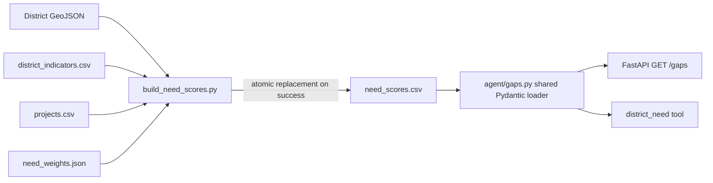

# Design Document: Gap Finder

## Overview

The Gap Finder remains a local, rebuildable pipeline. It extends `scripts/build_need_scores.py` to validate the district universe against local GeoJSON, calculate reproducible metrics in memory, stage a complete CSV beside `data/geo/need_scores.csv`, and atomically replace the committed file only after every validation and write succeeds. The service reads that generated file through one Pydantic-validated loader in `agent/gaps.py`; both `GET /gaps` and the `district_need` agent tool use that loader.

This is intentionally read-only at the API boundary. A funding-gap flag describes current committed funding relative to need; it neither allocates funds nor asserts a funding outcome.

## Architecture



## Components and Interfaces

| Component | Responsibility | Change |
|---|---|---|
| `scripts/build_need_scores.py` | Validate all local inputs, calculate scores/funding/gaps, preserve provenance, atomically publish the CSV. | Extend existing builder. |
| `data/geo/<districts>.geojson` | Local FeatureCollection defining the district universe and configured district-ID property. | Add/use project-local source input; no network access. |
| `data/geo/district_indicators.csv` | District metadata, indicators, provenance, and optional source snapshot date. | Existing source schema gains/uses `snapshot_date`. |
| `agent/schemas.py` | Shared `DistrictNeedRecord` Pydantic contract and `IndicatorQuality` literal/enum. | Add contract only. |
| `agent/gaps.py` | Read-only complete-file CSV loader and canonical-ID lookup. | New module. |
| `agent/tools/district_need.py` | Agent-facing wrapper returning a record from `agent.gaps`. | Replace its private CSV parsing/output model. |
| `agent/app.py` | FastAPI route integration. No entrypoint is currently present in the inspected tree, so create it only if this feature is also establishing the expected API entrypoint; otherwise add the route to the actual entrypoint discovered at implementation time. | Add `GET /gaps` route. |
| `agent/tests/` | Deterministic builder, loader, tool, route, and Hypothesis property coverage. | Extend focused test files or add narrowly scoped files. |

## Data Models

### Input conventions

The builder receives four explicit `Path` arguments, retaining its existing testable dependency injection pattern:

- `districts_geojson_path`: FeatureCollection file.
- `indicators_path`: district indicator CSV.
- `projects_path`: normalized project CSV.
- `weights_path`: JSON object of configured positively oriented indicator weights.
- `output_path`: committed `need_scores.csv` path.

The GeoJSON district-ID property is a named builder configuration constant (for example `DISTRICT_ID_PROPERTY = "district_id"`). Each Feature must contain exactly one non-empty string in that property. IDs are opaque and must satisfy the existing `CANONICAL_ID_PATTERN`; no display-name mapping or geographic inference is permitted.

The indicator CSV retains the existing required columns and adds `snapshot_date` as a source field. Every row must have exactly one canonical `district_id`, non-empty `district_name`, finite positive `population`, a quality of `measured`, `estimated`, or `illustrative`, non-empty `source`, and non-empty `source_url`. Configured indicators must be finite. An absent snapshot is represented internally and in output as `TBD: needs source`; actual dates must be accepted only when `date.fromisoformat` accepts the complete calendar date.

### Shared Pydantic model

Add the following conceptual model to `agent.schemas`:

```text
DistrictNeedRecord
  district_id: canonical identifier
  district_name: non-empty string
  need_score: finite float in [0, 1]
  funded_commitments_usd: finite float >= 0
  commitments_per_capita: finite float >= 0
  funding_gap: boolean
  indicator_quality: measured | estimated | illustrative
  snapshot_date: ISO calendar date | "TBD: needs source"
  source: non-empty retained label
  source_url: non-empty retained URL/string
```

`DistrictNeedRecord` inherits the existing canonical-ID validation base, uses strict finite numeric validation, and must not coerce an invalid source date or provenance value into a replacement value. The CSV header order is exactly the model's field order specified in Requirement 4.2.

The public collection payload is `list[DistrictNeedRecord]`. A filtered response is a single `DistrictNeedRecord`, not a one-item list.

## Build Flow

1. Read GeoJSON, indicators, projects, and weights into memory before opening a staged output file.
2. Validate GeoJSON parsing, `FeatureCollection` type, Feature shape, configured property, canonical ID format, and unique IDs. Report validation errors with enough context to identify the offending feature/ID.
3. Validate all indicator rows and compare the exact GeoJSON and indicator ID sets. The error reports IDs missing from either side.
4. Validate weight columns, finite non-negative weights, and an `fsum` within `1e-12` of 1.0.
5. Validate indicator values and normalize each configured column. For non-constant values use `(value - min)/(max - min)`; for a constant column use `0.0` for every district.
6. Scan projects. Add only non-negative finite `amount_usd` values whose `district` exactly occurs in the canonical district set. Do not derive an assignment for blank or unmatched districts. Invalid amounts on a matched district fail the entire build and identify the source row.
7. Calculate funded commitments, per-capita funding, the nearest-rank inclusive bottom-quartile threshold, weighted need scores, and gap flags. Use `math.fsum` for summation. Sort records by `district_id`.
8. Validate each final record through `DistrictNeedRecord` before serialization. This prevents generated output from diverging from service contracts.
9. Write header and all rows to a same-directory temporary file. Flush and close it; then replace the output using `Path.replace`/`os.replace`. Clean up the temporary file on every failure. The existing output is not opened for overwrite until replacement.

The stage file must be in the target directory so replacement is atomic on the same filesystem. No mutation of raw, processed, or input geo files occurs.

## Calculation Details

For canonical district `d` and configured indicators `i`:

```text
normalized_i(d) = 0                              if max_i == min_i
                  (value_i(d) - min_i)/(max_i-min_i) otherwise
need_score(d) = fsum(weight_i * normalized_i(d))
commitments(d) = fsum(amount_usd of exact district matches)
per_capita(d) = commitments(d) / population(d)
quartile_index = max(0, ceil(0.25 * district_count) - 1)
threshold = sorted(per_capita values)[quartile_index]
funding_gap(d) = need_score(d) >= 0.6 and per_capita(d) <= threshold
```

No score rounding is performed before classification. String serialization uses a round-trip-safe representation so parsing it preserves the predicate result.

## Service and Agent Interfaces

### `agent/gaps.py`

Expose a small read-only API:

```text
load_gap_records(path=NEED_SCORES_PATH) -> list[DistrictNeedRecord]
get_gap_record(district_id, path=NEED_SCORES_PATH) -> DistrictNeedRecord
GapDataUnavailableError
GapRecordNotFoundError
```

`load_gap_records` reads and validates the complete file before returning any record. It rejects missing/unreadable files, wrong/missing headers, Pydantic-invalid rows, and duplicate IDs with a readable `GapDataUnavailableError`; it never returns a partial collection. It sorts valid records by `district_id` as a defensive service boundary even though the builder already writes sorted data. `get_gap_record` validates the requested ID through the shared contract path and raises `GapRecordNotFoundError` only after the complete dataset loaded successfully.

### FastAPI route

Add the endpoint to the established FastAPI application:

```text
GET /gaps?district_id={optional canonical ID}
```

| Condition | Response |
|---|---|
| No filter and valid file | `200` with sorted `list[DistrictNeedRecord]`. |
| Valid existing `district_id` | `200` with that `DistrictNeedRecord`. |
| Valid/non-valid unknown filter | `404` with a readable `error` response and no invented record. |
| Missing, unreadable, malformed, or partially invalid CSV | `503` with a readable `error` response and no partial response. |

The route does not recalculate data, write files, or invoke Bedrock. It converts the two loader exceptions to these responses. Response models reference the shared Pydantic contract.

### Agent tool adaptation

`agent.tools.district_need.district_need` delegates to `agent.gaps.get_gap_record`, then returns that record or an intentionally compatible projection if the tool must keep its present schema. It must not directly open or parse `need_scores.csv`, and unknown IDs retain a typed not-found error. This guarantees its facts match `GET /gaps` exactly.

## Error Handling

- Builder validation errors use concise `ValueError` messages naming the file/row/district/indicator where available.
- Before atomic replacement, any error leaves the committed output byte-identical.
- Temporary staging files are removed on errors and never become published data.
- The loader treats all CSV parsing, schema, duplicate-ID, and file access errors as unavailable data, rather than returning valid preceding rows.
- FastAPI converts unavailable data to `503` and missing individual records to `404`; neither condition produces fabricated values.
- No AWS, database, vector store, or external network dependency is introduced.

## Testing Strategy

Use focused pytest tests in the existing `.venv`; use Hypothesis only for pure numeric and validation functions. Property tests run at least 100 examples and include this tag format in their test metadata/docstrings: `Feature: gap-finder, Property N: <property text>`.

| Area | Test type | Coverage |
|---|---|---|
| GeoJSON and indicator validation | Unit/integration | Missing/malformed/non-FeatureCollection input, invalid/duplicate IDs, ID-set mismatch, invalid metadata and weights, and output preservation. |
| Builder output | Deterministic integration | Header/field order, ascending IDs, exact assignment aggregation, unmatched exclusion, provenance/snapshot preservation, deterministic rerun, and staged-write failure preservation. |
| Numerical helpers | Hypothesis | Bounds, constant normalization, monotonicity, exact quartile and gap predicate. |
| `DistrictNeedRecord`/loader | Unit/integration | Valid rows, each invalid contract dimension, duplicate rows, and all-or-nothing loading. |
| `/gaps` | FastAPI TestClient | Collection, known filter, missing filter, unavailable/malformed source. |
| `district_need` | Unit | Same record source as loader/API and typed unknown behavior. |

## Correctness Properties

*A property is a behavior that holds across all valid executions. These properties are executable with pure helper functions and Hypothesis; file, API, and atomic-write behavior remains covered by focused examples and integration tests.*

### Property 1: Canonical district universe validation

For any finite GeoJSON FeatureCollection and indicator ID set, validation accepts only a one-to-one set of valid canonical district IDs, and when the sets differ it reports the IDs absent from each set without producing a build result.

**Validates: Requirements 1.2, 1.4**

### Property 2: Indicator and weight validation rejects invalid numerical inputs

For any configured indicator row or weight map, validation rejects missing/non-finite configured indicator values, unavailable columns, negative or non-finite weights, and finite weight sums farther than `1e-12` from 1.0; it accepts only rows with required valid metadata and retained provenance.

**Validates: Requirements 1.5, 1.6, 1.7**

### Property 3: Normalization and weighted score bounds

For all finite valid positively oriented indicator datasets and valid need weights, normalized non-constant values equal the min-max formula, each normalized value is in `[0,1]`, and every resulting weighted Need Score is finite and in `[0,1]` without changing its funding-gap predicate through serialization.

**Validates: Requirements 2.1, 2.3, 2.4, 6.1**

### Property 4: Constant indicators normalize to zero

For any finite valid district dataset in which every value of one configured positively oriented indicator is equal, normalization assigns `0.0` to that indicator for every district.

**Validates: Requirements 2.2, 6.3**

### Property 5: Positive-weight indicator monotonicity

For any two otherwise identical finite valid datasets where one district's value for one strictly positive-weight positively oriented indicator does not decrease, the changed district's Need Score does not decrease.

**Validates: Requirements 2.5, 6.2**

### Property 6: Exact-assignment commitment aggregation

For any canonical district set and finite valid project collection, each district's funded commitments equal the sum of non-negative amounts from exactly matching project district IDs, and changing unmatched or missing assignments cannot change any district total.

**Validates: Requirements 3.1, 3.2**

### Property 7: Funding per-capita, quartile, and gap classification

For any finite valid positive populations, non-negative commitments, and Need Scores, per-capita funding equals commitments divided by population, the threshold equals the specified sorted nearest-rank value, and a district is a funding gap exactly when its score is at least `0.6` and its funding is at or below that threshold, including every qualifying tie.

**Validates: Requirements 3.4, 3.5, 3.6, 3.7, 6.4**

### Property 8: District Need Record contract validation

For any generated record that meets all contract constraints, Pydantic validation preserves its field values; for any mutation that makes a canonical ID, required text, numeric bound/finiteness, quality, snapshot date, or provenance invalid, validation rejects the record.

**Validates: Requirements 5.1, 5.2**

## Requirements Traceability

All remaining requirements are intentionally verified with focused integration or example tests rather than properties: source loading and failure preservation (1.1, 1.3, 3.3), quality retention (2.6), reproducible CSV creation/provenance/snapshot/atomicity (4.1–4.8), and loader/route/tool behavior (5.3–5.7). This avoids using generative tests for filesystem, CSV, and HTTP infrastructure while preserving deterministic coverage.
