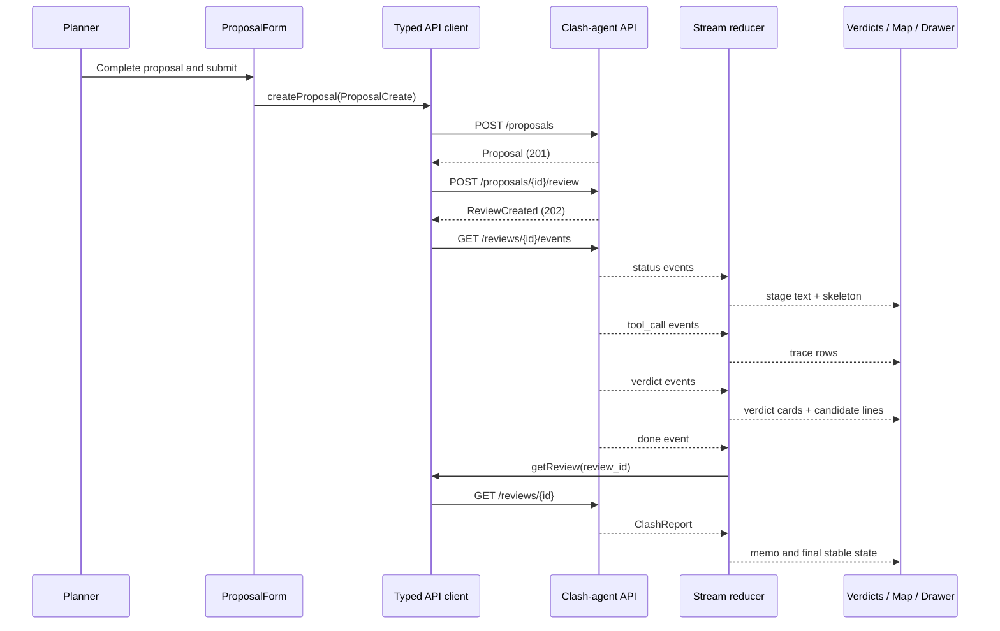
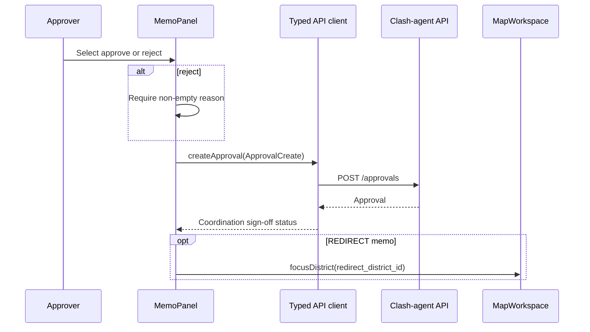

# Design Document: Planner Dashboard

## Overview

The Planner Dashboard is the Atlas11 single-page React 18 + Vite + TypeScript interface for submitting an urban-development proposal, viewing a validated clash review as it streams from the FastAPI service, and recording a human coordination decision. At the required 1366×768 projector size, it keeps intake and verdicts visible in a fixed left panel, makes the need-and-funding map the central workspace, and opens memo, agent-trace, and approval controls in a right drawer.

The frontend is a typed API client, not an authority over review state. It mirrors `agent/schemas.py` at the JSON boundary, treats API IDs and `source` values as canonical, renders only persisted or streamed validated review data, and never represents approval or a redirect as funding, allocation, or delivery.

## Architecture

```mermaid
graph LR
    U[Planner / Approver] --> App[App shell]
    App --> Header[Header: role + snapshot]
    App --> Left[Left panel: ProposalForm + VerdictList]
    App --> Map[Centre: MapWorkspace]
    App --> Drawer[Right drawer: MemoPanel + AgentTrace]
    App --> Client[Typed API client]
    Client --> API[FastAPI clash-agent API]
    Client --> SSE[GET /reviews/{id}/events]
    SSE --> State[Review stream reducer]
    State --> Left
    State --> Map
    State --> Drawer
    Geo[Local district GeoJSON + need scores] --> Map
```

**Boundaries**
- `frontend/src/types/` owns TypeScript representations that serialize compatibly with the Pydantic contracts in `agent/schemas.py`; no `any`, display-name ID replacement, or frontend-only verdict labels are permitted.
- `frontend/src/api/` owns REST calls, SSE parsing, typed API errors, and the base URL configuration. It does not contain React rendering.
- `frontend/src/pages/PlannerDashboard.tsx` composes the three desktop zones and shared state hooks. Feature components own visual behavior only.
- `frontend/src/components/MapWorkspace.tsx` renders local GeoJSON district polygons through Leaflet/react-leaflet, OpenStreetMap tiles, project pins, proposal pin, candidate lines, and map focus. Map tiles are the only cached-demo network dependency.
- `frontend/src/components/` includes `ProposalForm`, `VerdictCard`, `MemoPanel`, `AgentTrace`, `GapCallout`, `RoleToggle`, `SeededBadge`, and small accessible primitives.

## Layout and Responsive Contract

```mermaid
flowchart LR
    H[Header: Atlas11 | Planner/Approver | snapshot date]
    L[Left 360px\nProposal form\nReview progress\nVerdict cards]
    C[Flexible centre\nLeaflet need choropleth\nPins and relation lines]
    R[On-demand right drawer\nMemo\nAgent trace\nApproval controls]
    H --- L
    H --- C
    H --- R
```

At a viewport of **1366×768**, the desktop shell has a persistent header, a 360px left panel, a flexible map centre, and a closed-by-default right drawer that overlays rather than collapses the map. The left panel scrolls internally so submission fields and report cards remain usable. The map retains a meaningful minimum visible width when the drawer is open. Below the desktop breakpoint, the dashboard may stack panels, but the 1366×768 layout is the acceptance target.

## Sequence Diagrams

### Submit, review, and SSE render flow



### Approval/rejection flow



## Components and Interfaces

### Dashboard page and state hook

```typescript
export type ReviewStage =
  | "idle"
  | "submitting"
  | "creating-review"
  | "streaming"
  | "complete"
  | "error";

export interface DashboardState {
  role: Role;
  proposal: Proposal | null;
  reviewId: string | null;
  report: ClashReport | null;
  streamEvents: SseEvent[];
  stage: ReviewStage;
  error: ApiError | null;
  drawerOpen: boolean;
  focusedDistrictId: string | null;
}

export interface UseReviewWorkflow {
  state: DashboardState;
  submitProposal(input: ProposalCreate): Promise<void>;
  approve(): Promise<Approval>;
  reject(reason: string): Promise<Approval>;
  setRole(role: Role): void;
  openDrawer(): void;
  focusDistrict(districtId: string): void;
}

export function useReviewWorkflow(): UseReviewWorkflow;
```

**Responsibilities**
- `submitProposal` transitions through `submitting`, `creating-review`, and `streaming`; it starts the SSE connection only after a `ReviewCreated` response.
- The hook derives display state from typed events and accepts final report state only after terminal `done` followed by `GET /reviews/{reviewId}` success.
- The hook closes the stream and transitions to `error` on terminal `error`, malformed event payload, connection failure, or a typed API error.
- It exposes approval methods only as actions; `MemoPanel` decides whether they are visually enabled from `role`, `report`, and proposal status.

### ProposalForm

```typescript
export interface ProposalFormProps {
  initialValue?: Partial<ProposalCreate>;
  disabled: boolean;
  onSubmit(input: ProposalCreate): Promise<void>;
}
```

`ProposalForm` collects title, description, canonical city ID, optional canonical district ID, sector, non-negative budget, optional dates, and optional scenario key. It performs immediate client-side checks for required fields, date order, and non-negative budget for usability, but renders server validation as authoritative. The canonical cached scenario may be selected deliberately; seeded state is visibly labelled after the returned record confirms `source: "seeded"`.

### VerdictCard

```typescript
export interface VerdictCardProps {
  verdict: Verdict;
  project: Project | undefined;
  selected: boolean;
  onSelect(projectId: string): void;
}
```

Each card displays a text label and matching color, project name/funder/amount when resolved, a labelled confidence meter, concrete matching-attribute tags, and an expandable rationale. It uses label colors consistently: `DUPLICATE #C0392B`, `OVERLAPPING #D68910`, `COMPLEMENTARY #138D75`, and `UNRELATED #7F8C8D`; text labels are always present. Selecting a card highlights its pin and candidate line on the map.

### MapWorkspace

```typescript
export interface DistrictFeatureProperties {
  district_id: string;
  name: string;
  need_score: number;
  commitments_per_capita?: number;
  snapshot_date?: string;
}

export interface MapWorkspaceProps {
  districts: GeoJSON.FeatureCollection<GeoJSON.Geometry, DistrictFeatureProperties>;
  projects: Project[];
  proposal: Proposal | null;
  verdicts: Verdict[];
  focusedDistrictId: string | null;
  onDistrictFocused(districtId: string): void;
}
```

The map colors local district polygons sequentially by `need_score` from 0 to 1 and exposes each district’s ID, score, snapshot date, and available commitment context in an accessible popup/legend. It renders project pins differentiated by funder shape, a pulsing proposal pin, and lines from the proposal to resolved candidate projects colored and labelled by verdict. It must preserve the distinction between a redirect as a coordination focus and funded commitments.

### MemoPanel, AgentTrace, and GapCallout

```typescript
export interface MemoPanelProps {
  memo: Memo | null;
  proposalStatus: ProposalStatus | null;
  role: Role;
  submittingDecision: boolean;
  onApprove(): Promise<void>;
  onReject(reason: string): Promise<void>;
  onShowAudit(): void;
}

export interface AgentTraceProps {
  events: SseEvent[];
}

export interface GapCalloutProps {
  redirectDistrictId: string | null;
  onShowOnMap(districtId: string): void;
}
```

The drawer opens on memo, trace, or an explicit card action. `AgentTrace` shows tool-call events vertically with name and duration and maps status events to human-readable progress such as “Searching projects…”, “Checking overlap…”, and “Drafting memo…”. `MemoPanel` shows approve/reject controls only for `role === "approver"` and `status === "REVIEWED"`; rejection displays a required reason field. `GapCallout` is shown only for a `redirect_district_id`, states that the redirect changes coordination focus only, and flies the map to that district.

## Data Models

The API models mirror `agent/schemas.py` field names, enum values, JSON date/time encoding, and source labels. `Decimal` values serialize as JSON strings or numbers according to the API response and are accepted by the UI client as a string-safe `MoneyValue` for formatting without precision loss.

```typescript
export type CanonicalId = string;
export type MoneyValue = string | number;

export type ProposalStatus = "SUBMITTED" | "REVIEWED" | "APPROVED" | "REJECTED";
export type VerdictLabel = "DUPLICATE" | "OVERLAPPING" | "COMPLEMENTARY" | "UNRELATED";
export type Recommendation = "MERGE" | "CO_FINANCE" | "PROCEED" | "REDIRECT";
export type Role = "planner" | "approver";
export type ProposalSource = "seeded" | "user";
export type ReportSource = "live" | "seeded";
export type ProjectSource = "worldbank_api" | "iati" | "seeded";

export interface ProposalCreate {
  title: string;
  description: string;
  city_id: CanonicalId;
  district_id: CanonicalId | null;
  sector: string;
  budget_usd: MoneyValue;
  start_date: string | null;
  end_date: string | null;
  scenario_key: string | null;
  source: ProposalSource;
}

export interface Proposal extends ProposalCreate {
  proposal_id: CanonicalId;
  status: ProposalStatus;
  submitted_at: string;
}

export interface Project {
  project_id: CanonicalId;
  name: string;
  funder: string;
  country: string;
  city: string | null;
  district: string | null;
  sector: string;
  themes: string;
  description: string;
  amount_usd: MoneyValue;
  approval_date: string | null;
  closing_date: string | null;
  status: string | null;
  is_urban: boolean;
  source: ProjectSource;
  source_url: string | null;
}

export interface Verdict {
  project_id: CanonicalId;
  label: VerdictLabel;
  confidence: number;
  matching_attributes: string[];
  reasoning: string;
}

export interface Memo {
  recommendation: Recommendation;
  summary: string;
  redirect_district_id: CanonicalId | null;
}

export interface ClashReport {
  proposal_id: CanonicalId;
  candidates: Verdict[];
  memo: Memo;
  model_id: string;
  latency_ms: number;
  source: ReportSource;
}

export interface ReviewCreated { review_id: CanonicalId; }

export interface ApprovalCreate {
  review_id: CanonicalId;
  decision: "APPROVED" | "REJECTED";
  actor: string;
  role: Role;
  reason: string | null;
}

export interface Approval {
  approval_id: CanonicalId;
  review_id: CanonicalId;
  proposal_id: CanonicalId;
  actor: string;
  role: Role;
  decision: "APPROVED" | "REJECTED";
  decided_at: string;
  reason: string | null;
}

export type SseEventType = "status" | "tool_call" | "verdict" | "done" | "error";
export interface SseEvent {
  type: SseEventType;
  name?: string | null;
  ms?: number | null;
  payload?: Record<string, unknown> | null;
}
```

**Validation and conversion rules**
- IDs are opaque stable strings. The UI must submit and use `city_id`, `district_id`, `project_id`, `proposal_id`, and `review_id` verbatim rather than deriving IDs from display names.
- The stream parser validates `type`, optional `name`, finite non-negative `ms`, and object-or-null `payload` before reducing an event. A `verdict` event payload must parse into `Verdict`; the final report is retrieved as `ClashReport` rather than constructed from partial events.
- `source: "seeded"` receives `SeededBadge`; project provenance uses its own `ProjectSource` label and is never shown as live data.
- Snapshot date comes from local district metadata/data loading and is displayed as “Data snapshot: {date}”; if unavailable it displays “Data snapshot date unavailable”, never inventing a current date.

## API Client and Stream Algorithm

```typescript
export interface ClashApi {
  createProposal(payload: ProposalCreate): Promise<Proposal>;
  createReview(proposalId: CanonicalId): Promise<ReviewCreated>;
  streamReviewEvents(
    reviewId: CanonicalId,
    handlers: ReviewEventHandlers,
    signal: AbortSignal,
  ): Promise<void>;
  getReview(reviewId: CanonicalId): Promise<ClashReport>;
  createApproval(payload: ApprovalCreate): Promise<Approval>;
}

export interface ReviewEventHandlers {
  onEvent(event: SseEvent): void;
  onError(error: ApiError): void;
}

export async function runReview(
  proposal: Proposal,
  api: ClashApi,
  dispatch: React.Dispatch<ReviewAction>,
  signal: AbortSignal,
): Promise<void> {
  dispatch({ type: "reviewRequested", proposal });
  const { review_id } = await api.createReview(proposal.proposal_id);
  dispatch({ type: "reviewCreated", reviewId: review_id });
  await api.streamReviewEvents(review_id, {
    onEvent: (event) => dispatch({ type: "streamEvent", event }),
    onError: (error) => dispatch({ type: "streamFailed", error }),
  }, signal);
}
```

**Preconditions**
- A proposal response has a canonical `proposal_id` and `SUBMITTED` status before creating its review.
- The supplied abort signal remains active until navigation, unmount, retry, or terminal stream event.
- API responses and SSE JSON are untrusted until runtime parsing succeeds.

**Postconditions**
- A successful review renders one or more status events, tool calls before verdict events, verdict cards for validated stream payloads, and fetches the persisted report only after `done`.
- A terminal `error`, parser failure, HTTP error, or connection failure renders a readable error and does not enable approval controls or pretend a final report exists.
- Aborting or unmounting closes the stream and prevents state changes after cleanup.

**Reducer invariants**
- While `stage === "streaming"`, every accepted event has passed runtime validation and the stored stream order is unchanged.
- After a terminal `done` or `error`, no later event changes the state for that review ID.
- `report !== null` only after `getReview(reviewId)` returns a validated report matching the current proposal ID.

## Map Algorithm

```typescript
function mapVerdictsToLinks(
  proposal: Proposal | null,
  verdicts: Verdict[],
  projectsById: ReadonlyMap<CanonicalId, Project>,
): CandidateLink[] {
  if (proposal === null) return [];

  return verdicts.flatMap((verdict) => {
    const project = projectsById.get(verdict.project_id);
    const endpoints = coordinatesForProposalAndProject(proposal, project);
    return endpoints === null
      ? []
      : [{ projectId: verdict.project_id, label: verdict.label, endpoints }];
  });
}
```

**Preconditions:** both proposal and candidate have resolved map coordinates. A project lacking coordinates is represented in its verdict card but has no fabricated pin or line.

**Postconditions:** every rendered relation line corresponds to one received verdict and uses its closed label color plus accessible text. Redirect focus only changes camera/selection state; it does not modify district commitment, need, or funding values.

**Loop invariant:** each emitted link has a unique `projectId` and a label in `VerdictLabel`.

## Correctness Properties

### Property 1: Contract fidelity

**Validates: Requirements 2.1, 2.2, 2.4**

For every serializable frontend request and response model, fields and enum values accepted at the API boundary are compatible with the corresponding `agent.schemas` Pydantic contract; unknown backend enum values fail visibly rather than silently coercing.

### Property 2: Terminal stream safety

**Validates: Requirements 4.6**

For every event sequence accepted by the reducer, no event following terminal `done` or `error` can alter the rendered review state.

### Property 3: Approval authority

**Validates: Requirements 7.4, 7.5**

For any dashboard state, the client can send an approval request only when the selected role is `approver`, the proposal is `REVIEWED`, and a report/review ID exists; a rejection request includes non-whitespace reason text.

### Property 4: Verdict rendering closure

**Validates: Requirements 5.1, 5.2**

For every valid `Verdict`, its UI representation contains its text label, confidence, matching attributes, and reasoning; the label color mapping is total for exactly the four API labels.

### Property 5: Redirect non-financiality

**Validates: Requirements 6.5, 6.6**

For every redirect memo, applying “Show on map” changes only focused district/camera state and leaves all local funding and commitments values unchanged.

### Property 6: Seeded provenance

**Validates: Requirements 5.4**

Every displayed report or proposal with `source === "seeded"` includes a seeded indicator; records from other source values do not receive that indicator.

### Property 7: Map-link consistency

**Validates: Requirements 6.3, 6.4**

Every candidate line has a matching rendered verdict and canonical project ID; projects without coordinates produce no invented geographic line.

## Error Handling

| Condition | UI response | Recovery |
|---|---|---|
| Form validation failure | Inline field message; submit remains disabled until locally valid | Edit fields and resubmit. |
| API 422 / 404 / 409 | Readable non-stack-trace panel/toast with server detail | Preserve entered data; allow correction or new proposal. |
| API 502 review output failure | Review error panel; no report, approval, or memo action | Allow user to retry according to server lifecycle state. |
| API 503 expired AWS credentials | Persistent banner: “AWS credentials expired. Refresh agent/.env from Workshop Studio.” | Offer cached scenario if available; do not crash. |
| Cached report unavailable | Readable cached-demo-unavailable message | Preserve form and existing completed review; do not substitute live data. |
| SSE parse/network failure | Stop skeleton, show stream failure, disable decision actions | Retry only through a valid API review state; clean up connection. |
| Unknown event/enum | Treat as incompatible response and show readable compatibility error | Do not render a guessed label or recommendation. |
| Missing map coordinate or GeoJSON | Render non-map review content and a map-data warning | Keep all received review data visible. |

## Testing Strategy

### Unit tests (Vitest)
- API response/event parsing, API error mapping, request creation, and stream cleanup.
- Review reducer stage transitions, status messages, terminal event behavior, and final report matching.
- `ProposalForm` client validation and retention of server errors.
- `VerdictCard` text labels, color metadata, confidence formatting, details toggle, and seeded badge conditions.
- `MemoPanel` planner prohibition, approver availability, rejected reason requirement, and non-financial redirect copy.
- `MapWorkspace` need-score style selection, pin/link creation only with coordinates, selected candidate highlighting, and focus behavior.

### Property-based tests (fast-check)
- Generate valid `SseEvent` sequences to verify terminal-event immutability and tool-call-before-verdict ordering after validation.
- Generate each `VerdictLabel` and valid verdict fields to verify total, accessible card rendering and label-color mapping.
- Generate role/status/review combinations to verify approval UI action availability exactly matches approval authority.
- Generate redirect/funding map states to verify redirect focus never mutates commitment or funding values.
- Generate seeded/live report and proposal sources to verify seeded badges appear iff source is `seeded`.

### Integration and browser smoke tests
- Mock REST/SSE: submit a canonical seeded proposal → receive one `OVERLAPPING` and one `COMPLEMENTARY` verdict → retrieve `CO_FINANCE` report → switch to Approver → approve → show redirect target on map.
- Run the smoke scenario at 1366×768 with drawer open/closed, confirming controls are keyboard-operable and the map remains useful.
- Run an API-backed cached-mode smoke test with the actual FastAPI service when available; assert no AWS/Bedrock dependence, rendered seeded provenance, and readable agent trace.

## Performance and Accessibility

- Keep the single-page shell interactive during streaming: append trace/verdict updates incrementally and avoid recreating Leaflet layers unnecessarily.
- Use `React.memo`, stable map data references, and keyed layers for a small bounded candidate list. The interface assumes at most five model-facing candidates from the API design.
- Ensure role toggle, drawer, form fields, verdict expansion, map focus, and decision controls are keyboard operable; use labelled controls, semantic headings, focus trapping/return for the drawer, and non-color label text.
- Base type is 14px with 12px dense metadata and tabular numerals for monetary values; `formatMoney` outputs formats such as `US$240M` while retaining full raw values in accessible text.

## Security and Dependencies

The dashboard stores no AWS credentials, invokes no Bedrock service, and never logs request bodies containing secrets. It treats API/SSE payloads as untrusted, avoids dangerous HTML rendering of reasoning/memo text, and exposes no role-based security claim beyond the demo role toggle; the FastAPI service remains the authority for approval authorization.

Dependencies are React 18, TypeScript strict mode, Vite, Tailwind CSS, Leaflet, react-leaflet, OpenStreetMap tiles, Vitest, React Testing Library, and fast-check. Local GeoJSON and need-score data are loaded from `data/geo/` through the frontend’s supplied/static data path. No additional frontend framework, hosted map service, or external state-management library is required.
